# 틈 (TEUM) — 운전 부하 인지형 커뮤니케이션 매니저

차량 신호로 **운전 부하 지수(DLI)** 를 5Hz로 계산하고, 그 값에 맞춰 네 가지를 조율하는 Android Automotive OS(Pleos Connect) 앱입니다.

1. **AI 음성 대화**: 집중이 필요한 순간에는 말을 멈춥니다. 다시 여유가 생기면 "아까 ~ 이야기를 하던 중이었어요"라고 한 문장으로 요약한 뒤 끊긴 문장부터 이어 말합니다.
2. **알림**: 집중 단계에서는 보류했다가 틈 단계에서 한꺼번에 요약해 전합니다. 긴급한 알림은 예외입니다.
3. **동승자 신호**: 화면 가장자리 앰비언트 바와 아이용 '쉿 신호등'(오리지널 캐릭터 **또리**)으로 단계를 보여 줍니다.
4. **다른 앱과 부하 상태 공유**: 권한으로 보호한 바운드 서비스와 브로드캐스트로 부하 단계를 공유합니다.

| 단계 | 의미 | 음성 | 일반 알림 | 긴급 알림 |
|---|---|---|---|---|
| **집중** (DLI ≥ 65 즉시, < 50이 3초 유지되면 이탈) | 운전에 집중 | 즉시 중단 | 보류 | 보류(집중을 벗어나면 가장 먼저) |
| **주의** | 그 외 | 계속 | 보류 | 즉시 |
| **틈** (DLI < 30이 2초 유지, 또는 차속 0 + 기어 D) | 여유 | 계속, 끊긴 말 요약 재개 | 일괄 요약 전달 | 즉시 |
| **틈 OFF**(기준 비교) | 시연 대조군 | 모두 즉시 통과 | 즉시 | 즉시 |

사전 보류: 다음 기동 지점까지 15초 안이면 긴 음성은 새로 시작하지 않습니다.

---

## 시연 영상과 화면

모두 Pleos Connect Emulator v2.1.0에서 실제로 앱을 실행해 찍었습니다(2026-11-08). 메시지와 보낸 사람은 시연용 가상 데이터입니다.

### 고속도로 시나리오 100초

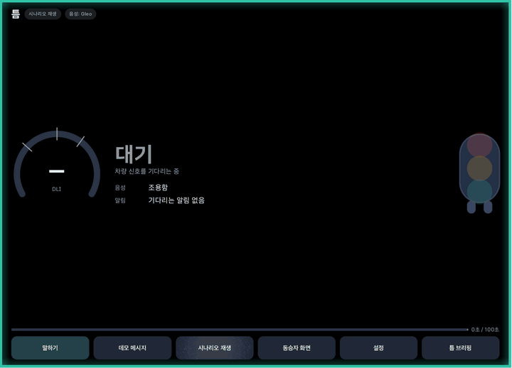

- 위 GIF는 100초를 약 13초로 줄인 빨리 감기입니다.
- 원본 영상: [demo-highway-100s.mp4 내려받기](https://github.com/duqorrhdrks/teum-pleos-app/raw/master/docs/media/demo-highway-100s.mp4)
  - 12MB, 에뮬레이터 전체 화면이고 길이는 1분 52초입니다.
  - 화면 녹화라 소리는 들어 있지 않습니다.
- 흐름: 정속 주행 '틈' → 합류 접근 '주의' → 합류 '집중'(약 39초, 음성 중단·알림 보류) → 다시 '틈'(긴급 알림 먼저, 끊긴 이야기 요약 뒤 이어 말하기, 모인 알림 일괄 전달) → 100초에 주행 끝 브리핑

### 주행 단계별 화면

| 틈 | 주의 |
|---|---|
| 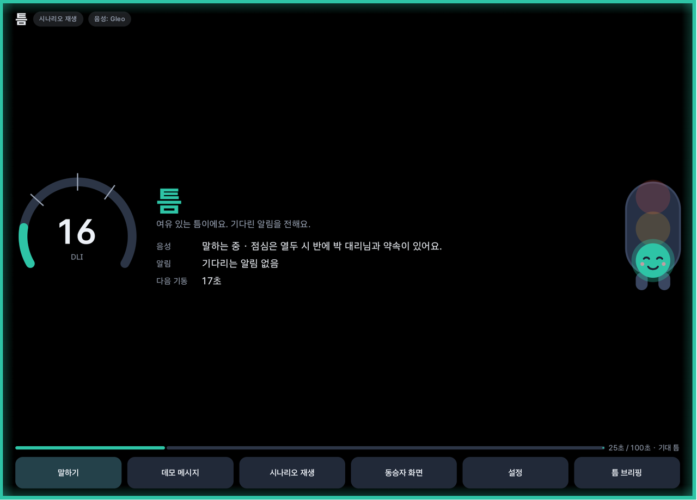 | 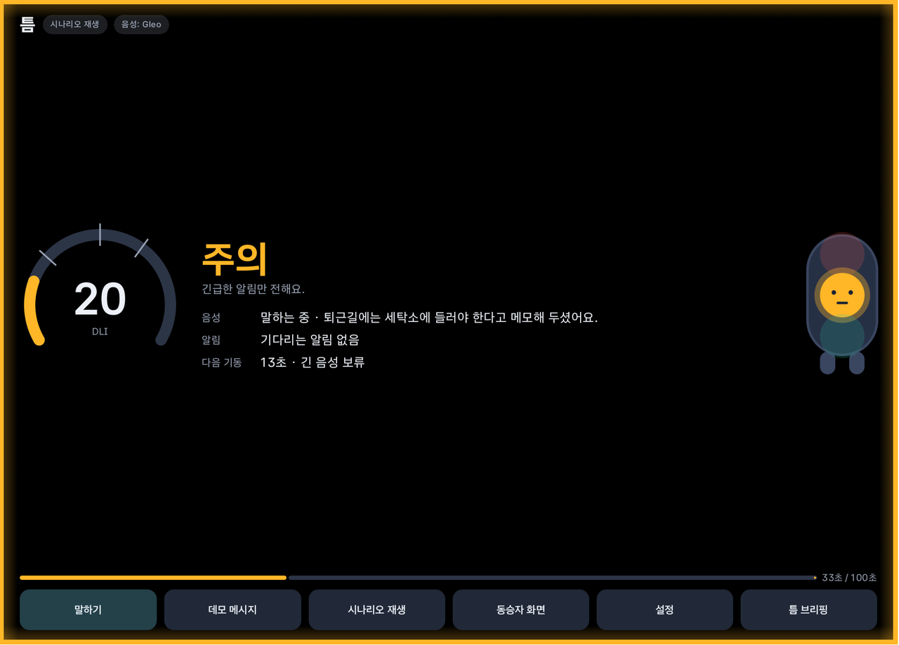 |
| AI가 말하고, 다음 기동까지 남은 시간을 보여 줍니다 | 긴급한 알림만 바로 전합니다. 기동 15초 전이라 긴 음성은 새로 시작하지 않습니다 |

| 집중 | 다시 틈: 요약하고 이어 말하기 |
|---|---|
| 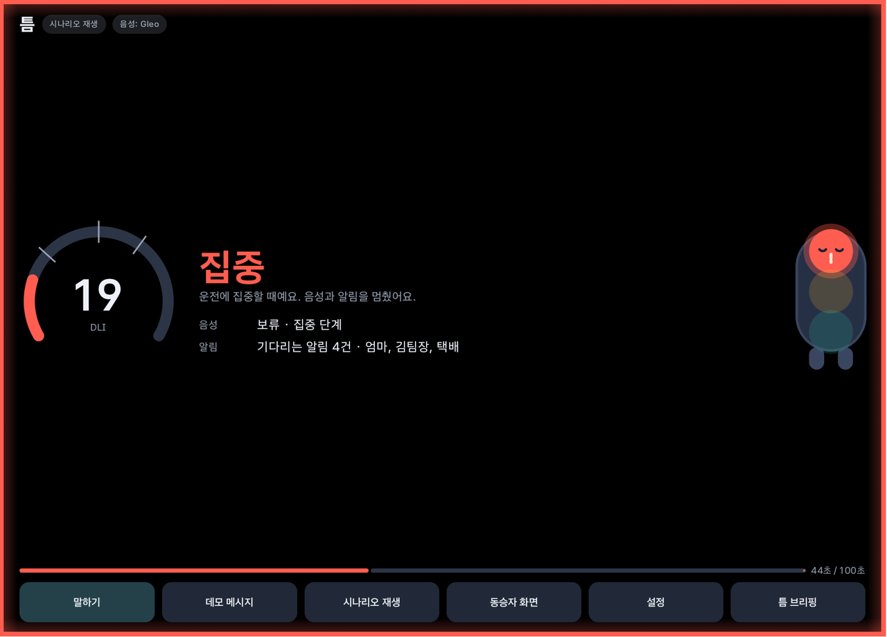 | 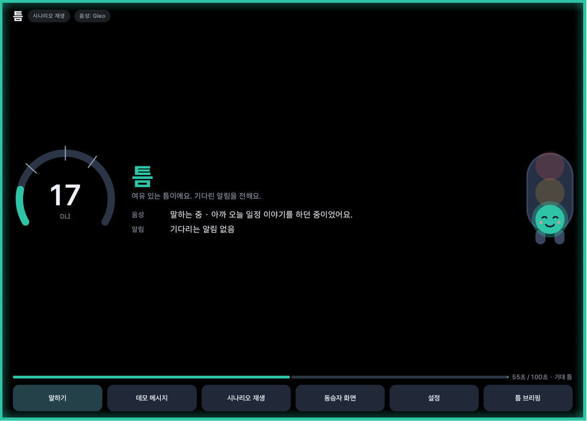 |
| 음성을 멈추고 알림 4건을 보류합니다. 화면 테두리가 빨갛게 바뀝니다 | 긴급 알림을 먼저 전한 뒤, 끊긴 이야기를 한 문장으로 요약하고 끊긴 문장부터 이어 말합니다 |

### 동승자 신호와 다른 앱 연동

| 쉿 신호등 '또리'(집중 중) | 부하 인지 API 연동 예제 앱(집중 중) |
|---|---|
| 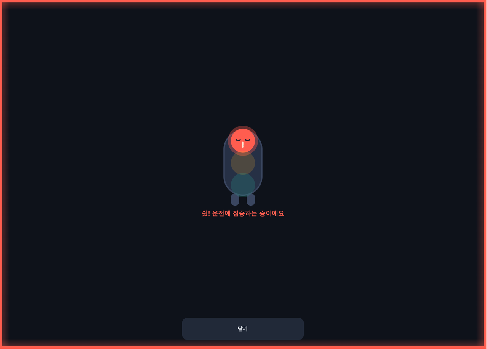 | 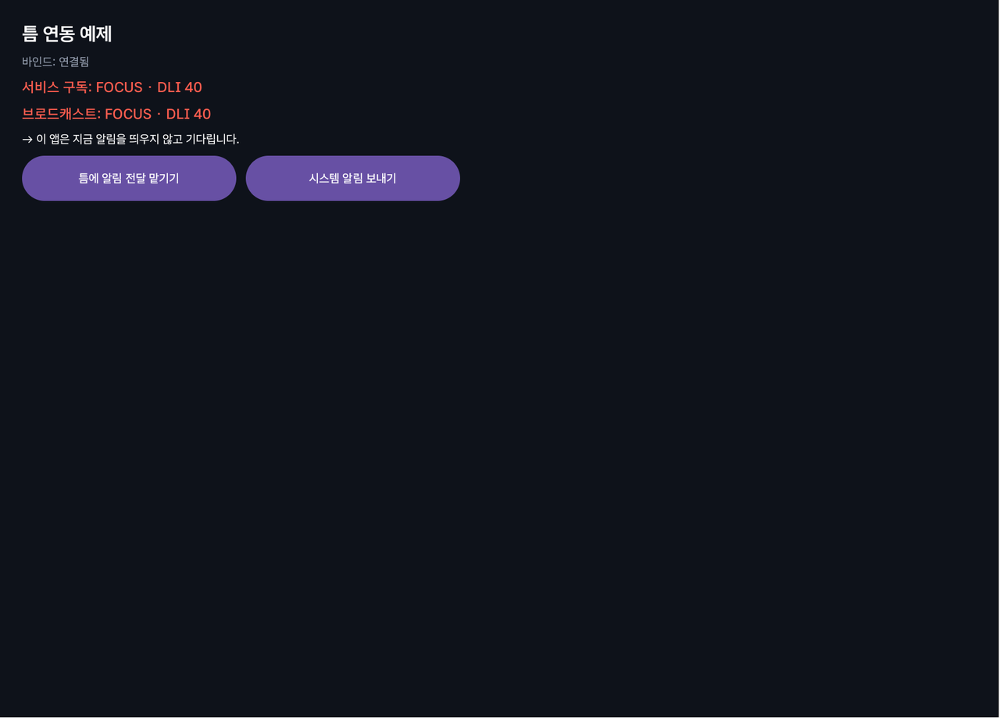 |
| 동승자, 특히 아이에게 지금은 말을 걸지 말라고 알립니다 | 다른 앱이 서비스·브로드캐스트로 FOCUS를 받고, 알림을 띄우지 않고 기다립니다 |

### 주행 끝 브리핑과 설정

| 틈 브리핑 | 설정 |
|---|---|
| 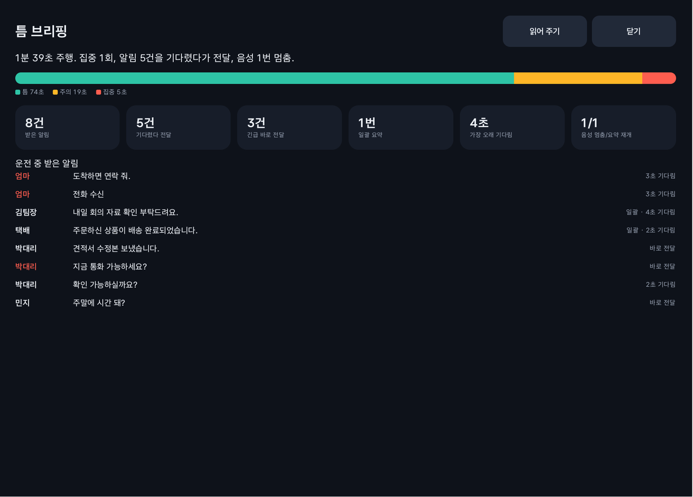 | 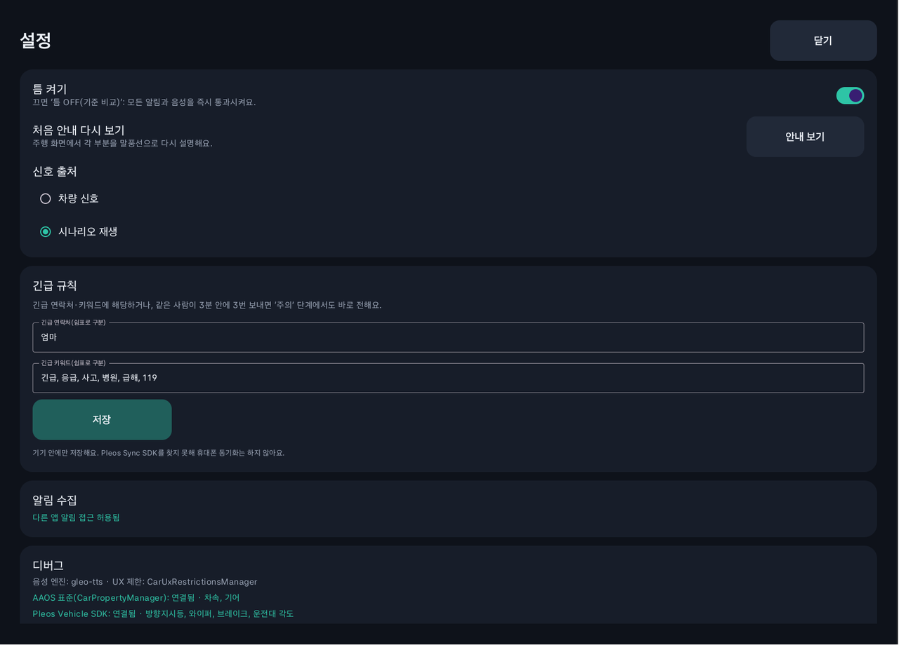 |
| 단계별 시간, 기다렸다 전달한 알림, 긴급 알림, 음성 멈춤과 요약 재개 횟수를 정리합니다 | 틈 켜기/끄기(기준 비교), 처음 안내 다시 보기, 신호 출처, 긴급 연락처·키워드를 정합니다 |

### 처음 실행 안내

| 운전 부하 지수 설명(1/5) | 쉿 신호등 설명(4/5) |
|---|---|
| 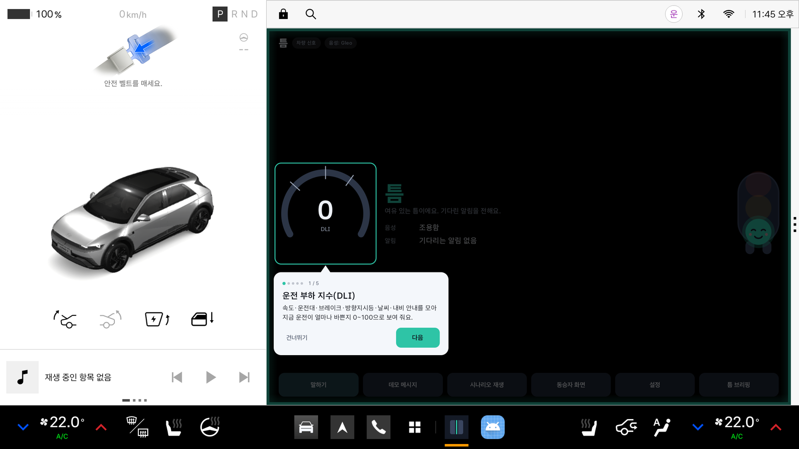 | 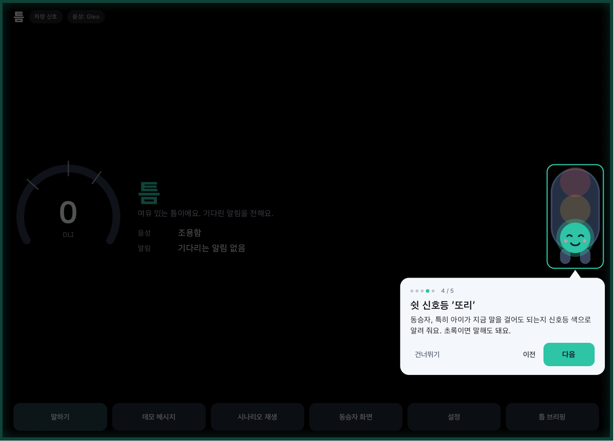 |

처음 실행하면 정차 중에만 말풍선 5개로 화면 각 부분을 설명합니다. 왼쪽 사진은 Pleos 차량 화면 전체입니다.

---

## 아키텍처

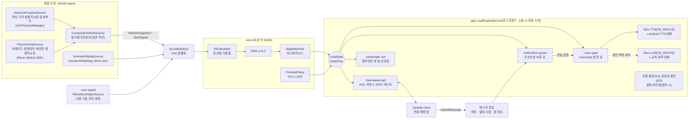

### 모듈

| 모듈 | 내용 | 안드로이드 의존 |
|---|---|---|
| `:core-dli` | DLI 계산, EMA, 단계 상태머신, 사전 보류, 5Hz 티커 | 없음(순수 Kotlin) |
| `:vehicle-signal` | `VehicleSignalSource`, AAOS 표준 / Pleos / 합성 / 시나리오 재생 | Car API, Pleos Vehicle |
| `:navi-signal` | NaviHelper 다음 기동 지점, TurnType → 기동 유형 변환 | Pleos NaviHelper |
| `:voice-gate` | 문장 단위 TTS 큐, 중단·요약 재개, 사전 보류, 긴급 끼어들기, Gleo TTS/STT/LLM 어댑터 | Pleos TTS·STT·LLM |
| `:notification-queue` | 긴급 규칙, 우선순위 보류 큐, 일괄 요약, 알림 수집 서비스, 데모 소스 | NotificationListenerService |
| `:passenger-cue` | 앰비언트 엣지 바, 쉿 신호등 캐릭터 '또리'(Compose Canvas로 직접 그림) | Compose |
| `:load-aware-api` | AIDL 계약, 서버 베이스, 클라이언트 헬퍼, 제출 검증·속도 제한 | AIDL |
| `:app` | `LoadEngine`, 포그라운드 서비스, 부팅 수신자, 화면 4종, 브리핑 저장 | Hilt, Compose, DataStore |
| `:sample-client` | 부하 인지 API 연동 예제 앱 | – |

---

## 운전 부하 지수(DLI) 사양

시연 시뮬레이터와 같은 상수를 씁니다. 정본은 [`core-dli/.../DliSpec.kt`](core-dli/src/main/kotlin/app/teum/core/dli/DliSpec.kt)입니다.

| 항목 | 식 | 최대 |
|---|---|---|
| 속도 | clamp((v − 60) / 60) × 15 | 15 |
| 조향 속도 | clamp(\|dθ/dt\| / 90°/s) × 20 (운전대 기준) | 20 |
| 종방향 가속도 | clamp(\|a\| / 3 m/s²) × 15 (센서값 우선, 없으면 차속 변화로 계산) | 15 |
| 브레이크 | 밟으면 10 | 10 |
| 방향지시등 | 켜면 10 | 10 |
| 기동 지점 근접 | d < 500m이면 (1 − d/500) × 복잡도 × 20 (합류 1.0 · 분기 0.9 · 차로 감소 0.8 · 출구 0.7 · 직진 0) | 20 |
| 날씨 | 와이퍼 0/1/2/3단 → 0 / 0.3 / 0.6 / 1.0 × 10 | 10 |

- 계산 주기는 200ms이고, 합산값을 EMA(α = 0.3)로 스무딩합니다.
- 신호가 없으면 그 항목은 0점으로 두고, 디버그 화면과 주행 화면에 '신호 없음'으로 표시합니다.
- 내비가 미지원이거나 실패하면 `naviAvailable = false`로 두고 기동 항목은 0점입니다.
- 이 저장소에서 정한 세부 규칙(사양 문서에 없던 부분)은 다음과 같습니다.
  - '차속 0' 판정은 0.5km/h 미만입니다(센서 잡음 때문).
  - 신호가 1초 넘게 끊겼다가 돌아오면, 그 샘플의 미분 항목(조향 속도·가속도)은 0으로 둡니다.
  - 집중 단계를 유지하는 조건이 '정차 = 틈' 규칙보다 우선합니다.
  - Pleos 브레이크·방향지시등·와이퍼는 값이 바뀔 때만 옵니다. 구독에 성공했으면 첫 값이 오기 전까지 꺼짐(0점)으로 두고, '신호 없음'은 구독 자체가 안 된 신호에만 표시합니다. 와이퍼는 구독 직후 스위치 위치(`getCurrentWiperSwitch`)를 한 번 읽어 실제 값으로 바꿉니다.

### 신호 출처(표준 우선 정책)

| 신호 | 1순위 | 2순위 | 이유 |
|---|---|---|---|
| 차속 | AAOS `PERF_VEHICLE_SPEED` | – | Pleos Vehicle SDK에 차속 도메인 없음 |
| 기어 | AAOS `GEAR_SELECTION` | – | Pleos `Gear.registerGearSelection`은 SDK가 직접 "use the Google GEAR_SELECTION property"라며 deprecated 처리 |
| 방향지시등 | AAOS `TURN_SIGNAL_STATE` | Pleos `TurnSignal` | 표준 권한(CAR_EXTERIOR_LIGHTS)이 시스템 권한일 수 있음 |
| 운전대 각도 | Pleos `SteeringWheel` | AAOS `PERF_STEERING_ANGLE` × 조향비 15 | 표준 속성은 **앞바퀴 각**이라 운전대 기준(90°/s)과 단위가 다름 |
| 브레이크 페달 | Pleos `Brake` | – | 공개 VehiclePropertyIds에 없음 |
| 와이퍼 단계 | Pleos `Wiper`(상태 + 스위치 위치) | – | 공개 VehiclePropertyIds(android-35)에 없음 |
| 가속도 | – | 차속 변화로 계산 | 공개 가속도 센서 속성 없음 |
| 다음 기동 | Pleos `NaviHelper.onTBTInfo` | – | 표준 API 없음 |

---

## 사용한 SDK·API와 확인 방법

SDK의 클래스·메서드·권한은 추측하지 않았습니다. 다음 세 가지로 확인했습니다.
- 공식 문서
- 공식 샘플(Pleos-Playground GitHub)
- Pleos Connect Emulator에서 실제로 실행

모든 모듈이 Pleos 저장소(nexus-playground)의 실제 SDK에 맞춰 컴파일됩니다.

| SDK / API | 좌표·버전 | 쓰는 곳 | 권한 | 문서 |
|---|---|---|---|---|
| Pleos Vehicle | `ai.pleos.playground:Vehicle:2.3.2` | `PleosVehicleSource` | `pleos.car.permission.CAR_DRIVE`(Brake·SteeringWheel), `CAR_LIGHTS`(TurnSignal), `CAR_WINDOWS`(Wiper) | [Getting Started](https://document.pleos.ai/en/docs/pleos-only/getting-started) · [Project setup](https://document.pleos.ai/en/docs/pleos-only/connect-sdk-pleos/Vehicle/project-setup) · [Permissions](https://document.pleos.ai/en/docs/pleos-only/connect-sdk-pleos/Vehicle/vehicle-permission) · [API Reference](https://document.pleos.ai/en/docs/pleos-only/connect-sdk-pleos/Vehicle/entry) |
| Pleos NaviHelper | `ai.pleos.playground:NaviHelper:3.0.5` | `PleosNaviHelperSource` | `pleos.car.permission.NAVI_ROUTE` | [Importing](https://document.pleos.ai/docs/pleos-only/connect-sdk-pleos/NaviHelper/importing-sdk) · [Permissions](https://document.pleos.ai/docs/pleos-only/connect-sdk-pleos/NaviHelper/declaring-permissions) |
| Gleo TTS (Pleos TextToSpeech) | `ai.pleos.playground:TextToSpeech:3.3.1` | `GleoTtsEngine` (ON_DEVICE) | `pleos.car.permission.TTS_SERVICE` | [Importing](https://document.pleos.ai/docs/pleos-only/connect-sdk-pleos/TextToSpeech/importing-sdk) · [Permissions](https://document.pleos.ai/docs/pleos-only/connect-sdk-pleos/TextToSpeech/declaring-permissions) · [Start/Stop](https://document.pleos.ai/docs/pleos-only/connect-sdk-pleos/TextToSpeech/start-and-stop) |
| Gleo STT (Pleos SpeechToText) | `ai.pleos.playground:SpeechToText:3.3.1` | `GleoSpeechInput` (ON_DEVICE) | `pleos.car.permission.STT_SERVICE` | [Importing](https://document.pleos.ai/docs/pleos-only/connect-sdk-pleos/SpeechToText/importing-sdk) · [Permissions](https://document.pleos.ai/docs/pleos-only/connect-sdk-pleos/SpeechToText/declaring-permissions) |
| Gleo LLM (Pleos LLM) | `ai.pleos.playground:LLM:2.1.3.2` | `GleoLlmSummarizer`, `GleoChat` (ON_DEVICE) | `pleos.car.permission.LLM_SERVICE` (에뮬레이터에서 granted 확인) | 공개 문서 페이지 없음 |
| Maven 저장소 | `https://nexus-playground.pleos.ai/repository/maven-releases/` | `settings.gradle.kts` (ai.pleos.* 그룹만) | – | 위 문서 |
| AAOS CarPropertyManager | `useLibrary("android.car")` | `AaosCarPropertySource` | `android.car.permission.CAR_SPEED`(런타임), `CAR_POWERTRAIN`, `READ_CAR_STEERING` | [CarPropertyManager](https://developer.android.com/reference/android/car/hardware/property/CarPropertyManager) · [VehiclePropertyIds](https://developer.android.com/reference/android/car/VehiclePropertyIds) |
| AAOS CarUxRestrictionsManager | 〃 | `UxRestrictions` | – | [CarUxRestrictionsManager](https://developer.android.com/reference/android/car/drivingstate/CarUxRestrictionsManager) · [Driver distraction guidelines](https://source.android.com/docs/automotive/driver_distraction/guidelines) |
| Android TextToSpeech | 플랫폼 | `AndroidTtsEngine`(Gleo 대체) | – | [TextToSpeech](https://developer.android.com/reference/android/speech/tts/TextToSpeech) |
| NotificationListenerService | 플랫폼 | `TeumNotificationListener` | `BIND_NOTIFICATION_LISTENER_SERVICE` | [NotificationListenerService](https://developer.android.com/reference/android/service/notification/NotificationListenerService) |
| Pleos Connect Emulator | v2.1.0 (Android 14, API 34) | 시연 | – | [설치](https://document.pleos.ai/en/docs/connect/guide/getting-started/application-development/setup-connect-sdk-emulator) · [설정](https://document.pleos.ai/en/docs/connect/guide/getting-started/application-development/configure-pleos-connect-emulator) · [Virtual Console](https://document.pleos.ai/en/docs/connect/guide/getting-started/application-development/use-vehicle-emulator) |
| 공식 샘플 | – | API 사용법 확인 | – | [pleos-sample-vehicle-app](https://github.com/Pleos-Playground/pleos-sample-vehicle-app) · [pleos-sample-navi-app](https://github.com/Pleos-Playground/pleos-sample-navi-app) |

- minSdk 28은 Pleos 문서의 "minSdk API 28 or higher" 요구를 따릅니다.
- compileSdk/targetSdk 35는 Pleos 샘플 기준선을 따릅니다.
- 빌드 도구는 AGP 8.7.2, Gradle 8.11.1, Kotlin 2.0.21, JDK 17 바이트코드입니다.

**Sync SDK, Gleo 전용 SDK는 찾지 못했습니다.**
- nexus-playground의 `ai.pleos.playground` 그룹 전체 목록(2026-11-05 조회)에는 Vehicle, NaviHelper, TextToSpeech, SpeechToText, LLM, FusedLocation, placesense만 있고 Sync는 없습니다.
- 그래서 긴급 연락처 설정과 브리핑은 **기기 안에만 저장**하고 모바일 동기화는 하지 않습니다.
- Gleo AI 음성 스택은 위 TTS/STT/LLM SDK로 구현했습니다.
- Gleo Interface(App Schema로 음성 명령 받기, [core concepts](https://document.pleos.ai/en/docs/pleos-only/app-integration-guide/guide/core-concepts))는 Pleos 스키마 승인이 필요해 이번 범위에서 뺐습니다.

---

## 검증하지 못한 SDK 항목 (`TODO(verify-sdk)`)

| 위치 | 내용 |
|---|---|
| `app/src/main/AndroidManifest.xml` | SDK가 선언한 `INTERNET` 권한을 제거했습니다(외부 전송 차단). 에뮬레이터에서 Gleo TTS ON_DEVICE 발화는 INTERNET 없이 소리까지 나는 것을 확인했습니다(2026-11-07). 실차에서 다른 Pleos 기능이 INTERNET을 요구하는지는 확인이 필요합니다. |
| `navi-signal/.../PleosNaviHelperSource.kt` | ① `TBTInfo.distance` 단위: 미터로 가정했습니다. ② 안내 중 `onTBTInfo`가 자동으로 계속 오는지 확인하지 못해, 경로 안내 중에만 1초마다 `getTBTInfo()`를 요청합니다. |
| `navi-signal/.../NaviSignal.kt` | `TURN_DEVIDE_MERGE`의 정확한 의미(분기/합류)를 몰라 복잡도가 큰 '합류'로 보았습니다. |
| `vehicle-signal/.../AaosCarPropertySource.kt` | 운전대:앞바퀴 조향비 15는 고정값입니다. 차종 정보로 바꿔야 합니다. |
| `voice-gate/.../GleoEngines.kt` | ① 에뮬레이터에서 TTS `onStart`·`onDone`·`onStop`이 문장마다 오는 것을 확인했습니다. 모델이 깨진 상태에서는 `onDone`이 오지 않았으므로, 문장 길이의 2배가 지나면 끝난 것으로 보는 안전장치를 남겼습니다. ② LLM `onResponse(text, Boolean)`의 두 번째 인자를 '완료 여부'로 해석했습니다. 에뮬레이터는 기기 내 LLM이 꺼져 있어("on-device LLM is disabled") 요약은 규칙 기반(`HeuristicSummarizer`)으로 나갑니다. |
| (권한 보호 수준) | `READ_CAR_STEERING`, `CAR_EXTERIOR_LIGHTS`(TURN_SIGNAL_STATE)가 서드파티에 허용되는지는 기기에서 확인해야 합니다. 허용되지 않으면 Pleos 대체값 또는 '신호 없음'으로 동작합니다. |

---

## 플랫폼 제약

- **알림 수집**: AAOS에는 서드파티 앱에 '알림 접근'을 허용하는 설정 UI가 없을 수 있습니다.
  - 틈은 `NotificationAccess.isGranted()`로 먼저 확인합니다.
  - 허용되지 않으면 데모 메시지와 부하 인지 API 위임(`submitMessage`)으로 동작합니다.
  - 개발 중에는 `scripts/enable-notification-listener.sh`로 허용할 수 있습니다.
  - 사람이 보낸 메시지만 모읍니다. "○○이(가) 실행 중입니다" 같은 포그라운드 서비스 알림, 지울 수 없는 알림, 재생·진행률·내비 같은 상태 알림은 거릅니다(`isPersonMessage`).
  - 다른 앱의 원래 알림(헤드업 포함)은 건드리지 않습니다(취소·스누즈 없음). 원래 알림까지 미루려면 그 앱이 부하 인지 API를 써야 합니다.
- **전화**: 실제 전화 제어는 범위 밖입니다. 시나리오와 데모의 `call` 이벤트는 "전화가 왔었어요"라고 알리기만 합니다.
- **주행 중 UI**: 다음 두 화면만 `distractionOptimized`를 선언했습니다.
  - 주행 화면: 텍스트 입력과 스크롤 목록이 없습니다. `LIMIT_CONTENT`가 켜지면 메시지 미리보기와 현재 문장 글을 숨기고 건수만 보입니다.
  - 동승자 화면
  - 설정(텍스트 입력)과 브리핑(스크롤 목록)은 선언하지 않았으므로 주행 중에는 시스템이 띄우지 않습니다. 앱도 `CarUxRestrictions`를 다시 확인해 편집을 막습니다.
- **에뮬레이터 차이**: 타 팀 보고에 따르면 에뮬레이터는 주행 중 CarUxRestrictions 글자 제한을 적용하지 않고, GPS가 움직이지 않습니다. 그래서 시연은 `ScenarioReplaySource`로 합니다.
- **암시적 브로드캐스트**: Android 8 이상에서는 매니페스트 수신자가 `LOAD_STAGE_CHANGED`를 받지 못합니다. 런타임 등록 수신자나 바운드 서비스를 써야 합니다.
- **Pleos 권한 심사**: Pleos 차량 권한은 Pleos App Market과 사전 협의해 승인받은 것만 선언할 수 있습니다([앱 심사 가이드](https://document.pleos.ai/en/docs/pleos-only/distribute/app-review-guide)). 제출 전 아래 목록을 협의해야 합니다.
  - `CAR_DRIVE`, `CAR_LIGHTS`, `CAR_WINDOWS`
  - `NAVI_ROUTE`
  - `TTS_SERVICE`, `STT_SERVICE`, `LLM_SERVICE`

### 부하 인지 API 권한(protectionLevel 검토)

| 권한 | 수준 | 이유 |
|---|---|---|
| `app.teum.permission.READ_LOAD_STATE` | `normal` | 공개하는 값은 단계, 반올림한 DLI, 사전 보류 여부뿐입니다(차속·위치·조향 같은 원시 신호는 없음). 다른 앱이 주행 중 동의 창 없이 연동할 수 있어야 의미가 있습니다. 바인드는 서비스의 `android:permission`으로, 브로드캐스트는 수신자 권한으로 보호합니다. |
| `app.teum.permission.SUBMIT_MESSAGE` | `dangerous` | 운전자에게 음성으로 들려줄 내용을 넣는 권한이라 사용자 동의가 필요합니다. 서버는 길이 200자 제한, 제어 문자 제거, 앱별 분당 10건 제한을 겁니다. |

`signature`는 서드파티 연동이 불가능해서 쓰지 않았습니다. 권한 정의(`<permission>`)는 `:app` 매니페스트에만 둡니다. 공용 모듈에 두면 연동 앱에도 같은 정의가 들어가 서명 충돌로 설치가 실패합니다.

### 개인정보

- 주행 신호와 대화 문장은 기기 안에서만 처리합니다.
  - Gleo TTS/STT/LLM은 모두 `ON_DEVICE` 모드입니다.
  - SDK가 선언한 `INTERNET` 권한을 매니페스트에서 제거해, 외부로 나가는 경로 자체를 막았습니다.
- LLM 요약 프롬프트에는 대화 문장만 넣고 차량 신호·위치는 넣지 않습니다.
- 설정과 브리핑은 앱 내부 저장소에 둡니다. 클라우드 백업과 기기 이전 대상에서도 뺐습니다(`data_extraction_rules.xml`, `allowBackup=false`).

---

## 빌드와 테스트

```bash
echo "sdk.dir=$HOME/Android/Sdk" > local.properties   # Android SDK 경로
./gradlew :core-dli:test testDebugUnitTest            # 단위 테스트(JUnit5 + Turbine)
./gradlew assembleDebug                               # app-debug.apk, sample-client-debug.apk
```

| 모듈 | 테스트 | 확인하는 것 |
|---|---|---|
| `:core-dli` | 40 | 항목별 점수, EMA, 히스테리시스, 사전 보류, 5Hz 티커, **정속(틈) / 차선 변경(주의) / 합류(집중) / 신호 정차(틈) 벡터** |
| `:vehicle-signal` | 8 | 시나리오 보간, 신호 끊기, 실시간 재생, **고속도로 시나리오 전 구간 기대 단계 일치**, 합성 우선순위, 구독 직후 꺼짐 기본값 |
| `:navi-signal` | 19 | TurnType 변환, 내비 미지원 시 기동 항목 0, **멈춘 내비 값 거르기**(달리는데 거리가 그대로면 버림) |
| `:voice-gate` | 11 | 문장 분할, 중단 후 요약 재개(요약 준비·요약 문장도 화면 상태에 표시), 사전 보류(짧은 알림은 통과), 긴급 끼어들기, 집중 중 쌓인 알림 순서, **집중 이탈 직후 풀린 긴급 알림이 대화 재개보다 먼저**, 엔진 사슬(자막 대체), 틈 OFF, **시나리오 합류 구간 중단 → 정속 구간 요약 재개** |
| `:notification-queue` | 9 | 긴급 규칙 3종, 다른 앱 알림 거르기(실행 중·상태 알림 제외), 단계별 보류·통과, 일괄 요약 문구, 틈 OFF, **시나리오 집중 구간 보류 → 긴급 우선 + 일괄 요약** |
| `:load-aware-api` | 2 | 제출 속도 제한, 입력 검증 |
| `:app` | 1 | 주행 끝 감지, 브리핑 집계 |

---

## 에뮬레이터 시연 절차

1. **에뮬레이터 준비**([공식 문서](https://document.pleos.ai/en/docs/connect/guide/getting-started/application-development/setup-connect-sdk-emulator))
   - Android Studio → SDK Manager → SDK Update Sites에 `https://nexus-playground.pleos.ai/repository/raw-releases/connect-avd/2.x/crp-sys-img.xml`(Windows/Linux)를 추가합니다.
   - API 34의 `Pleos Connect v2.1.0` 시스템 이미지를 설치합니다(압축 4.1GB).
   - AVD를 만듭니다: Automotive, RAM 6GB 이상, **Boot: Cold**. Quick boot로 두면 VHAL을 쓸 수 없습니다.
   - 또는 `scripts/start-emulator.sh`: `TEUM_Pleos` AVD를 콜드 부팅하고 앱 설치·실행·Virtual Console 포트 연결까지 합니다.
2. **설치와 시나리오 재생**
   ```bash
   scripts/run-demo.sh          # 틈 ON: 고속도로 시나리오 100초
   scripts/run-demo.sh --off    # 틈 OFF(기준 비교): 같은 시나리오, 모두 즉시 통과
   ```
   앱 안에서 **시나리오 재생** 버튼을 눌러도 됩니다. 진행 막대 옆에 '기대 단계'가 표시됩니다.
3. **시나리오에서 볼 장면**(`scenarios/highway_demo.json`)

   | 시각 | 상황 | 기대 동작 |
   |---|---|---|
   | 0–28초 | 비 오는 고속도로 100km/h 정속 | 틈. 12초부터 AI가 오늘 일정 브리핑(9문장) 시작 |
   | 27.6초~ | 합류 지점 ETA 15초 이내 | 사전 보류: 29초에 들어온 긴 뉴스는 시작하지 않고 대기 |
   | 28.4–33.4초 | JC 램프 감속·곡선 | 주의(브리핑은 계속) |
   | 33.4–34.4초 | 램프 끝 잠깐 여유 | 틈(짧은 틈) |
   | 34.4–39.4초 | 합류 준비(방향지시등·조향) | 주의 |
   | 39.4–44.0초 | 본선 합류(가속·조향·합류 지점 근접) | **집중**: 말하던 문장 즉시 중단. 이 사이에 온 김팀장·엄마(긴급 연락처) 메시지, 엄마 전화, 택배 알림을 모두 보류 |
   | 44.0초~ | 정속 복귀 | 틈: 엄마 메시지·전화(긴급)를 **가장 먼저** 전함 → "아까 오늘 일정 이야기를 하던 중이었어요." → 끊긴 문장부터 재개 → 김팀장·택배 일괄 요약. 대화 중 새 긴급 알림은 문장 경계에서 끼어듦. 대화가 끝나면 보류했던 뉴스 시작 |
   | 61–65.8초 | 차선 변경, 박대리 3연속 메시지 | 61초는 틈이라 바로 전달. 62.4초부터 주의라 두 번째(63초)는 보류. 세 번째(64초)는 반복 수신 규칙(3분 안에 3번)으로 긴급이 되어 바로 전달. 보류분은 65.8초 틈에 전달 |
   | 85.4–90.8초 | 출구 감속 | 주의 |
   | 90.8초~ | 감속 막바지, 92초 요금소 D단 정차 | 틈(정차 중에는 '차속 0 + D' 규칙으로 계속 틈) |
   | 97초 | P단 | 3초 뒤 주행 끝 → **틈 브리핑** 생성 |

   위 시각은 테스트(`ScenarioTest`, `ScenarioQueueTest`, `VoiceGateTest`)에서 확인한 값입니다. 에뮬레이터 실시간 재생에서는 합류 구간 DLI가 65 근처에서 오르내려 집중 진입이 1~2초 일찍 올 수 있습니다(이탈 44초는 같음).
4. **실제 차량 속성 주입**(완료 기준 3)
   - 앱을 차량 신호 모드로: `adb shell am start -n app.teum/.ui.DrivingActivity --ez use_vehicle true` (또는 설정 → 신호 출처)
   - `scripts/inject-vhal.sh demo`를 실행하거나 `speed 100` / `gear D` / `steer 90` / `brake 60` / `turn left` / `wiper high`처럼 하나씩 넣습니다.
   - 직접 만져 보려면 브라우저에서 http://127.0.0.1:8088/ (Virtual Console)을 엽니다. Motion(기어·브레이크·운전대·가속), Convenience(와이퍼·방향지시등) 카드로 바꾸면 틈 화면의 DLI가 바로 반응합니다.
   - 설정 화면 '디버그'에서 항목별 기여도와 '신호 없음' 표시를 확인합니다(정차 중에만 열림).
   - 디버그 빌드는 1초마다 DLI와 항목별 기여도를 로그로 남깁니다: `adb logcat -s TeumDli`
5. **처음 실행 안내**: 앱을 처음 열면(정차 중) 주행 화면의 DLI 게이지 → 단계 → 음성·알림 → 쉿 신호등 → 버튼을 말풍선 5개로 차례로 설명합니다. 다시 보려면 설정 → '처음 안내 다시 보기' 또는 `adb shell am start -n app.teum/.ui.DrivingActivity --ez show_guide true`. 시나리오 재생 중이나 주행 중(CarUxRestrictions)에는 띄우지 않습니다.
6. **부하 인지 API**
   - `틈 연동 예제` 앱을 엽니다. 서비스 구독과 브로드캐스트 두 경로의 단계가 함께 바뀌는 것을 봅니다.
   - '틈에 알림 전달 맡기기'를 누르면 SUBMIT_MESSAGE 동의 후 틈의 큐로 들어갑니다.
7. **알림 수집**: `scripts/enable-notification-listener.sh`(앱이 도는 현재 사용자에게 허용) 후 `틈 연동 예제`의 **시스템 알림 보내기**를 누르면, 틈을 모르는 보통 앱 알림을 틈이 모아 단계에 맞춰 전합니다.

### 검증 현황

| 완료 기준 | 상태 |
|---|---|
| 1. 테스트 벡터 기대 단계 | 단위 테스트 통과 |
| 2. 에뮬레이터에서 DLI 게이지가 시나리오대로 움직임 | **Pleos 에뮬레이터에서 확인**: 틈 → 주의 → 집중(39초 무렵) → 틈 → 주의 → 틈, 100초에 주행 끝 브리핑 생성 |
| 3. adb 주입 값이 DLI에 반영 | **Pleos 에뮬레이터에서 확인**(`scripts/inject-vhal.sh demo`, 2026-11-07 재확인): 정속 틈(10) → 차선 변경 주의(30.6) → 비 와이퍼 +10 → 브레이크 감속 주의(최대 34.5) → 정차 틈 → P단 주행 끝 |
| 4. 합류 구간 중단 → 정속 구간 요약 재개 | 단위 테스트 통과 + **에뮬레이터에서 Gleo TTS 실제 음성으로 확인**(집중 진입 때 `onStop` → `Interrupted atSentence=6` → 긴급 알림 2건 → `Resumed summary=아까 오늘 일정 이야기를 하던 중이었어요.`) |
| 5–7. 알림·동승자·API·브리핑 | 로직 단위 테스트 통과. 에뮬레이터에서: 알림 보류·긴급 우선·일괄 요약·브리핑 생성, **다른 앱의 실제 시스템 알림을 집중 중 보류했다가 틈에 일괄 요약**, 틈 OFF 때 즉시 통과, 동승자·설정·브리핑 화면, 주행 중 설정·브리핑 버튼 잠김(CarUxRestrictions), 연동 예제 앱의 서비스 구독·브로드캐스트 수신(CAUTION · DLI 32) 확인 |

## 에뮬레이터 확인 결과 (Pleos Connect Emulator v2.1.0, 2026-11-06 ~ 11-07)

| 항목 | 결과 |
|---|---|
| 앱 설치·실행 | 정상. 드라이버 사용자(user 10)로 실행되며, 시동(부팅) 시 서비스 자동 시작 |
| Pleos Vehicle SDK | 조향·기어·차속 이벤트 수신 확인. 브레이크는 Virtual Console로 밟아야 값이 들어옴 |
| `pleos.car.permission.LLM_SERVICE` | 플랫폼에 존재하고 `granted=true` 확인 |
| 차량 값 주입 | `cmd car_service inject-vhal-event`는 user 빌드라 **거부**됨("requires non-user build"). 공식 Virtual Console의 HTTP API(`/vehicle/catalog`에 목록 공개)로 대체. 콘솔은 브라우저 세션 하트비트(`POST /browser/session`, 3초 만료)가 있어야 값을 받음 |
| Gleo TTS | ① `initialize()` 완료 **뒤에** `addEventListener()`를 불러야 함(먼저 부르면 SDK 내부 예외). ② 언어는 `Locale.KOREA`("ko-KR")여야 함("ko"는 "unsupported locale: ko-"). ③ 처음에는 `Failed to load MetaSpace byte pair encoder`로 소리가 나지 않았음. 원인은 에뮬레이터 음성 서비스(`ai.pleos.playground.caas`)에 남은 깨진 모델이었고, 모델 제공 앱의 1.17.1을 "version downgrade"로 거부하고 있었음. **`scripts/fix-emulator-tts.sh`**(음성 서비스의 에뮬레이터 내부 데이터 초기화)로 모델을 다시 받은 뒤 한국어 음성(haeun)으로 정상 발화. 그래도 실패하면 앱은 Gleo → Android TTS → **자막 엔진** 순서로 자동 전환하고 "음성 엔진 없음 · 자막으로 표시"를 띄움 |
| Sync | 에뮬레이터에 `ai.pleos.playground.service.sync` 서비스가 있으나, 공개 Maven 저장소에 Sync SDK가 없어 연동하지 않음 |
| 안정성 | 소프트웨어 렌더링(`swiftshader_indirect`, `lavapipe`)은 주행이 시작되면 1~3분 안에 에뮬레이터 RenderThread가 SIGSEGV로 죽음(gdb로 확인). **호스트 GPU(`-gpu host`, 기본값)** 에서는 주입 데모 6회 연속 안정. `start-emulator.sh`는 터미널을 닫아도 꺼지지 않게 systemd 사용자 서비스(`teum-emulator`)로 실행. GPU가 없는 PC는 `TEUM_GPU=swiftshader_indirect`. RAM 6GB 권장 |
| 내비 기동 정보 | 에뮬레이터는 차속을 넣어도 지도 위치가 움직이지 않아, 경로 안내 중이면 '좌회전 4m'가 계속 옴. 그대로 쓰면 도달 예상 0초로 긴 음성이 영원히 보류되므로, 달린 거리가 남은 거리+50m를 넘었는데 같은 값이면 버림(`StaleManeuverFilter`) |
| 다른 앱 알림 | `cmd notification post`는 user 0에 올라가 user 10의 틈이 받지 못함. 연동 예제 앱의 '시스템 알림 보내기'로 확인 |
| 시스템 실행 알림 | 부팅 직후 "MusicVisualizer이(가) 실행 중입니다"(포그라운드 서비스 알림)를 메시지로 읽었음. 실행 중·상태 알림을 거르도록 고친 뒤, 같은 알림을 다시 띄워도 무시하고 실제 메시지는 그대로 전하는 것을 확인(2026-11-08) |
| 요약 재개 표시 | 에뮬레이터의 기기 내 LLM은 응답이 없어 요약을 3초 기다린 뒤 규칙 기반 요약으로 넘어감. 그동안 화면에 '대기 2건'만 보였음. 지금은 '하던 이야기 이어 갈 준비 중' → '말하는 중 · 아까 ~ 이야기를 하던 중이었어요.' 순서로 보임(2026-11-08) |
| 방향지시등·와이퍼 '신호 없음' | 부팅 뒤 한 번도 조작하지 않으면 Pleos SDK가 값을 보내지 않아 주행 화면에 빨간 '신호 없음: 방향지시등'(또는 와이퍼)이 떴음. 표준 `TURN_SIGNAL_STATE`는 이 에뮬레이터에서 미지원. 구독 성공 시 꺼짐 기본값으로 해결(2026-11-08) |
| 방향지시등 | Pleos 시스템이 사각지대 카메라 창(`CarEvsBlindSpotCameraPreviewActivity`)을 화면 왼쪽 위에 띄움. 틈과 무관한 시스템 동작 |
